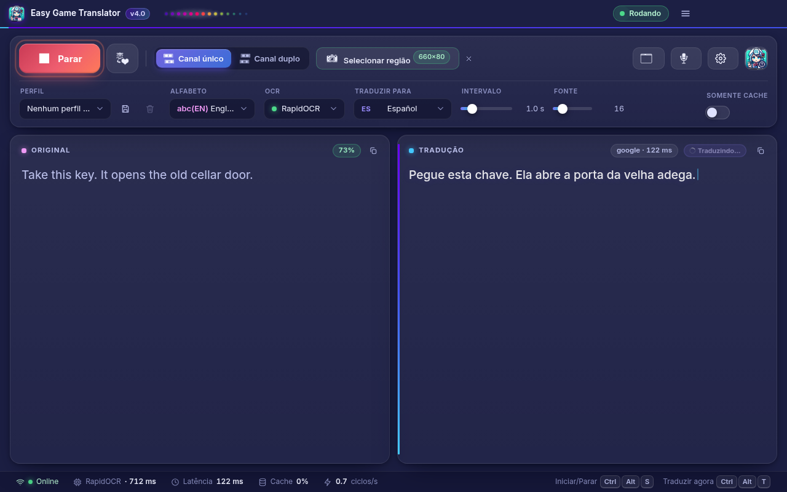
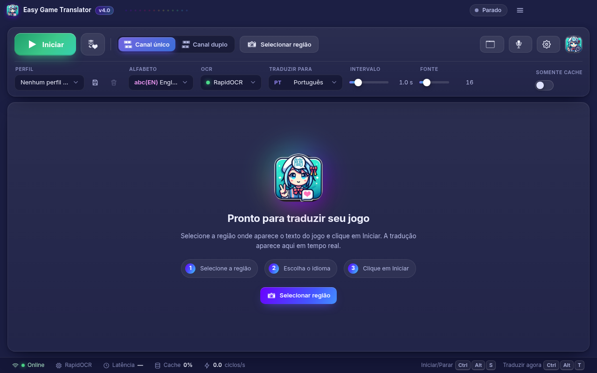
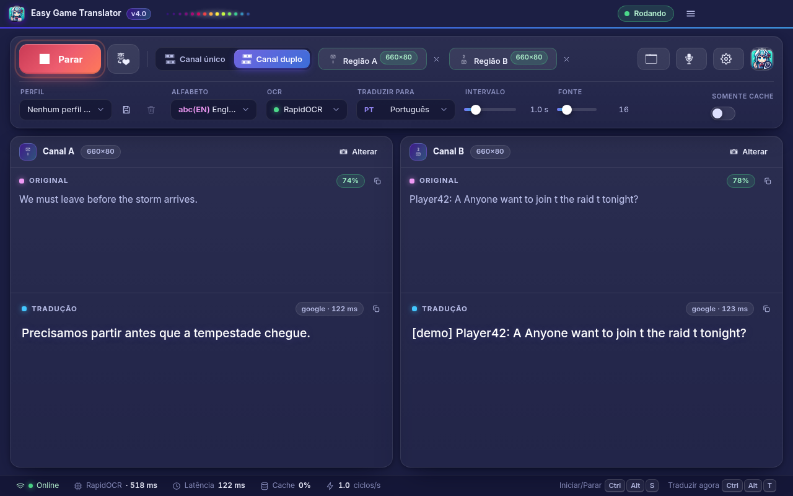
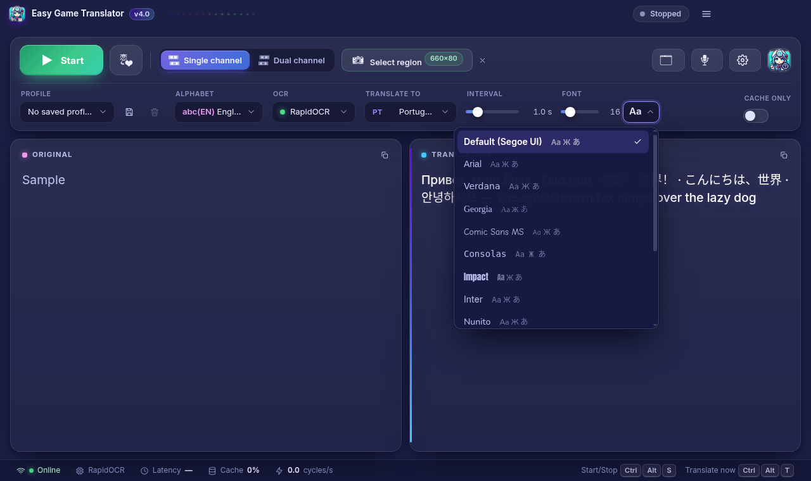
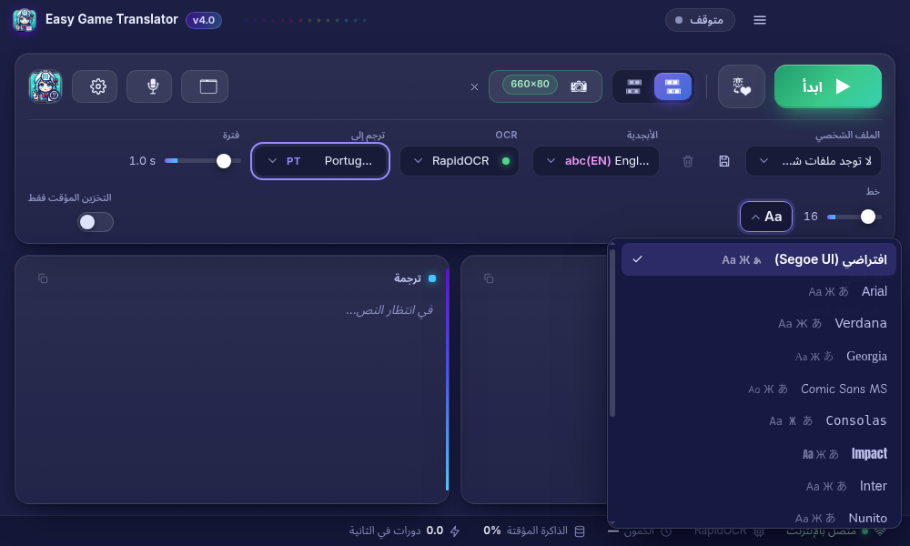
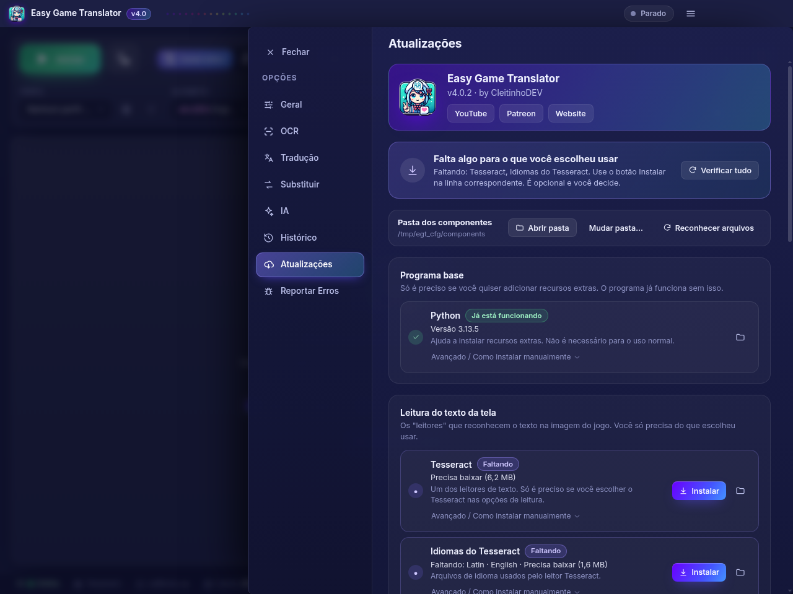
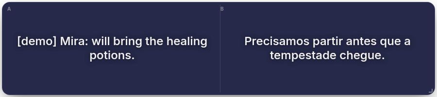

# Easy Game Translator v4

**Tradutor de jogos em tempo real com OCR** — por **CleitinhoDEV**.

Captura uma região da tela, lê o texto (OCR) e mostra a tradução na hora — na janela principal ou numa janela
flutuante (**Box Mode**) por cima do jogo. Interface em **Electron + React**, motor em **Python** (backend local FastAPI).
Funciona **offline** depois de instalado (OCR local, cache de traduções e motores offline opcionais).



> ✅ **Versão segura (estável) atual: [4.0.9](https://github.com/cleitinhodev/easy_game_translator/releases/tag/v4.0.9)** — branch [`stable-4.0.9`](https://github.com/cleitinhodev/easy_game_translator/tree/stable-4.0.9).
> A anterior, [4.0.6](https://github.com/cleitinhodev/easy_game_translator/releases/tag/v4.0.6), continua disponível (branch `stable-4.0.6`).
> Veja a [política de versão estável](#versão-estável-versão-segura).
>
> 📖 **Tutorial online com imagens:** <https://cleitinhodev.github.io/homepage/projects/easy-game-translator-tutorial/>

**Índice:** [O que é](#o-que-é) · [Download](#download-e-instalação) · [Iniciantes: Windows](#windows) · [Iniciantes: Linux](#linux) ·
[Primeiro uso](#primeiro-uso) · [Tradutores](#tradutores) · [IA](#ia-opcional) · [Scripts](#scripts) ·
[Segurança e privacidade](#segurança-e-privacidade) · [Versão estável](#versão-estável-versão-segura) ·
[Perguntas frequentes](#perguntas-frequentes) · [Compilar](#compilar-a-partir-do-código) · [Licença](#licença) · [English](#english-summary)

> 🇺🇸 [English summary below](#english-summary)

## O que é

O **Easy Game Translator** é um programa gratuito e de código aberto (GPL-3.0) para **traduzir jogos enquanto você joga**.
Você marca na tela o lugar onde aparece o texto do jogo (legenda, caixa de diálogo, chat); o programa **lê esse texto com OCR**
(reconhecimento de texto em imagem, feito no seu próprio PC) e mostra a **tradução na hora** — na janela principal ou numa
janelinha transparente por cima do jogo (**Box Mode**). Serve para jogos sem tradução para o seu idioma, visual novels,
RPGs antigos, chats de jogos online etc. Não mexe nos arquivos do jogo e não injeta nada nele: só olha a tela.

## Recursos

- **Vários motores de OCR**: RapidOCR (embutido, já funciona sem instalar nada), Tesseract, EasyOCR; Paddle/WinOCR experimentais.
  Pré-processamento (escala, cinza, inversão automática, contraste, limiar, nitidez), detecção de mudança e estabilização do texto.
- **14 tradutores** (grátis sem chave, com chave grátis, servidor próprio e offline) em ordem de prioridade, cada um com cartão
  próprio, **teste ao vivo** e aviso de privacidade; **cache SQLite** e modo **somente cache/offline** (veja [Tradutores](#tradutores)).
- **Box Mode**: janela transparente, sempre no topo, arrastável/redimensionável, fonte automática, click-through opcional e
  excluída de prints/gravações (para o OCR não ler a própria tradução).
- **Canal duplo**: duas regiões ao mesmo tempo (ex.: chat + legenda).
- **Perfis por jogo**, **glossário/substituições**, histórico (exportar TXT/CSV/JSON), atalhos globais configuráveis.
- **IA opcional** (desligada por padrão): **Gemini** ou **Ollama** local — só a escolhida entra na tradução.
- **Scripts** (novo na 4.0.9): use o **seu próprio script de tradução** (Python, Node.js, PowerShell, .bat, .sh, .exe…) no
  lugar dos tradutores ou da IA — veja [Scripts](#scripts).
- **Verificação automática na abertura**: durante a intro o programa testa os tradutores e **liga sozinho** os que responderem.
- **Privacidade**: capturas e OCR ficam no seu PC; chaves de API ficam **criptografadas** e presas a este computador (veja [Segurança e privacidade](#segurança-e-privacidade)).
- **Gerenciador de componentes** (Opções › Atualizações): instala só o que você escolher usar, com tamanho, confirmação e progresso.
- **Interface em 20 idiomas** (pt-BR, en, es, fr, de, it, ru, uk, pl, tr, nl, id, vi, th, ar com RTL, hi, ja, ko, zh-CN, zh-TW).
- **14 fontes** para o texto traduzido (de sistema + 7 embutidas sob OFL), com alternativas para CJK, árabe, tailandês, hindi e cirílico.
- Tradução manual (digitar ou falar) com narração, intro com a Nina, Mica/Acrílico no Windows 11.

| | |
|---|---|
|  |  |
|  |  |
|  |  |

## Download e instalação

**Versão atual (estável): [Easy Game Translator 4.0.9](https://github.com/cleitinhodev/easy_game_translator/releases/tag/v4.0.9)** — baixe só um arquivo, o do seu sistema:

| Sistema | Arquivo | Para quem |
|---|---|---|
| Windows 10/11 (64 bits) | [`EasyGameTranslator-4.0.9-setup.exe`](https://github.com/cleitinhodev/easy_game_translator/releases/download/v4.0.9/EasyGameTranslator-4.0.9-setup.exe) | **Instalador** — o mais indicado: cria atalhos e permite escolher a pasta |
| Windows 10/11 (64 bits) | [`EasyGameTranslator-4.0.9-portable.exe`](https://github.com/cleitinhodev/easy_game_translator/releases/download/v4.0.9/EasyGameTranslator-4.0.9-portable.exe) | **Portátil** — não instala nada, é só abrir (bom para pendrive ou PC sem permissão de instalar) |
| Linux x86_64 (qualquer distro, glibc 2.28+) | [`EasyGameTranslator-4.0.9-x86_64.AppImage`](https://github.com/cleitinhodev/easy_game_translator/releases/download/v4.0.9/EasyGameTranslator-4.0.9-x86_64.AppImage) | Sem instalar — veja [Linux](#linux) |
| Ubuntu / Debian / Mint / Pop!_OS | [`EasyGameTranslator-4.0.9-amd64.deb`](https://github.com/cleitinhodev/easy_game_translator/releases/download/v4.0.9/EasyGameTranslator-4.0.9-amd64.deb) | Instalador `.deb` (aparece no menu de aplicativos) |
| Todos | [`SHA256SUMS.txt`](https://github.com/cleitinhodev/easy_game_translator/releases/download/v4.0.9/SHA256SUMS.txt) | Impressões digitais SHA-256 para conferir o download |
| Scripts de exemplo | [`mymemory_tradutor.py`](https://github.com/cleitinhodev/easy_game_translator/releases/download/v4.0.9/mymemory_tradutor.py) · [`glossario_offline.js`](https://github.com/cleitinhodev/easy_game_translator/releases/download/v4.0.9/glossario_offline.js) · [`modelo_basico.py`](https://github.com/cleitinhodev/easy_game_translator/releases/download/v4.0.9/modelo_basico.py) | Veja [Scripts](#scripts) |

Página da versão (notas e todos os arquivos): <https://github.com/cleitinhodev/easy_game_translator/releases/tag/v4.0.9> · Todas as versões: [Releases](../../releases).

**Conferir o download (opcional, recomendado):** compare o resultado com o `SHA256SUMS.txt`.
- Windows (PowerShell): `Get-FileHash .\EasyGameTranslator-4.0.9-setup.exe -Algorithm SHA256`
- Linux: `sha256sum -c SHA256SUMS.txt --ignore-missing`

> **Aviso do SmartScreen**: o executável **não é assinado** digitalmente, então o Windows pode mostrar
> "O Windows protegeu o computador". Clique em **Mais informações → Executar assim mesmo**.

## Iniciantes

Guia passo a passo, em linguagem simples. Escolha o seu sistema: **[Windows](#windows)** (o mais fácil) ou **[Linux](#linux)**.

### Windows

Funciona no **Windows 10 ou 11 (64 bits)**. **Não precisa instalar Python** nem mais nada para começar.

1. **Baixe** um destes arquivos (veja a [tabela de downloads](#download-e-instalação)):
   - [`EasyGameTranslator-4.0.9-setup.exe`](https://github.com/cleitinhodev/easy_game_translator/releases/download/v4.0.9/EasyGameTranslator-4.0.9-setup.exe) → **instalador**: instala no computador
     (cria atalho na Área de Trabalho e no Menu Iniciar, aparece em "Aplicativos instalados" para desinstalar). Recomendado.
   - [`EasyGameTranslator-4.0.9-portable.exe`](https://github.com/cleitinhodev/easy_game_translator/releases/download/v4.0.9/EasyGameTranslator-4.0.9-portable.exe) → **portátil**: não instala nada,
     é só abrir (bom para pendrive). Demora um pouco mais para abrir, porque se descompacta a cada vez.
   - Na dúvida, use o **setup**. Os dois têm as mesmas funções e guardam as configurações no mesmo lugar.
2. **Abra o arquivo baixado.** Se aparecer a tela azul **"O Windows protegeu o computador"** (SmartScreen), clique em
   **Mais informações** e depois em **Executar assim mesmo**. Isso acontece porque o programa não tem assinatura digital paga —
   não quer dizer que tem vírus.
3. **Instale** (no setup): avance as telas; se quiser, escolha outra pasta. No final, marque "Executar" ou abra pelo atalho.
4. **Primeira vez**: aparece uma intro com a Nina e música (clique ou aperte `Esc` para pular). Depois abre a **tela principal**.
5. **Selecione a região**: clique em **Selecionar região** e arraste um retângulo sobre o lugar do jogo onde aparece o texto
   (legenda, caixa de diálogo, chat). Dá para trocar depois.
6. **Escolha os idiomas**:
   - **Alfabeto** = o idioma/escrita **do jogo** (ex.: `abc(EN)` para jogos em inglês, japonês, coreano…);
   - **Traduzir para** = o idioma em que **você** quer ler (ex.: Português).
7. **OCR** (o "leitor" do texto da tela): deixe **RapidOCR**, que já vem junto e funciona sem instalar nada.
8. Clique em **Iniciar** (ou `Ctrl+Alt+S`). A tradução aparece na hora, no painel **Tradução**.
9. **Box Mode** (opcional): clique no botão do Box Mode (ou `Ctrl+Alt+B`) para abrir uma janelinha só com a tradução, que fica
   **por cima do jogo**. Arraste e redimensione como quiser.
10. **Modo de tela do jogo**: use **Janela** ou **Janela sem borda** (*borderless*) nas opções de vídeo do jogo.
    Em **tela cheia exclusiva** o Windows não deixa nenhuma janela aparecer por cima.

**Internet**: a tradução online precisa de internet. O que já foi traduzido fica guardado (**cache**) e funciona offline depois.
O OCR (RapidOCR) roda no seu computador, sem internet.

**Extras opcionais** (só se quiser): em **Opções (⚙) › Atualizações** o programa mostra o que pode ser instalado
(por exemplo o **Tesseract**, outro leitor de texto) com tamanho e botão **Instalar**. Em **Opções › IA** dá para usar
o **Gemini** (cole sua chave, criada em <https://aistudio.google.com/apikey>) ou o **Ollama** local (<https://ollama.com/download>).
Nada disso é obrigatório.

**Se algo der errado no Windows**

- **O programa não abre ou o OCR falha**: instale o **Microsoft Visual C++ Redistributable 2015–2022 (x64)** pelo link oficial da
  Microsoft: <https://aka.ms/vs/17/release/vc_redist.x64.exe> (página oficial: <https://learn.microsoft.com/cpp/windows/latest-supported-vc-redist>).
  Reinicie o computador e abra de novo.
- **O antivírus bloqueou / apagou o arquivo**: é comum com programas novos sem assinatura digital ("falso positivo").
  Baixe só daqui do [Releases](../../releases/latest), confira o SHA-256 (veja `SHA256SUMS.txt`) e, se confiar, adicione uma exceção no antivírus.
- **Onde ficam os logs** (para reportar erros): **Opções › Reportar Erros** mostra o caminho e tem o botão **Abrir pasta de logs**.
  O arquivo é `%APPDATA%\EasyGameTranslator\logs\egt.log`.

### Linux

**Jeito fácil — programa pronto.** **Não precisa instalar Python** — o motor e o RapidOCR já vêm dentro.
Precisa de uma distro de 64 bits (x86_64) com glibc 2.28 ou mais nova (Ubuntu 20.04+, Debian 10+, Fedora 29+, Mint 20+…).

> **Antes de tudo — use uma sessão X11 (Xorg), não Wayland.** A captura de tela do programa usa o X11; no **Wayland** o sistema
> normalmente bloqueia a captura de outros programas e o OCR lê uma imagem preta. Para conferir: `echo $XDG_SESSION_TYPE`
> (deve mostrar `x11`). Para trocar: saia da sessão e, na tela de login, clique na engrenagem ⚙ e escolha **"Ubuntu on Xorg"**
> (ou "GNOME on Xorg", "Plasma (X11)" etc.).

**Opção A — AppImage (qualquer distro, sem instalar):**

1. Baixe [`EasyGameTranslator-4.0.9-x86_64.AppImage`](https://github.com/cleitinhodev/easy_game_translator/releases/download/v4.0.9/EasyGameTranslator-4.0.9-x86_64.AppImage).
2. Dê permissão de execução — no terminal, na pasta do download:

   ```bash
   cd ~/Downloads
   chmod +x EasyGameTranslator-4.0.9-x86_64.AppImage
   ./EasyGameTranslator-4.0.9-x86_64.AppImage
   ```

   (Ou pelo gerenciador de arquivos: botão direito → Propriedades → Permissões → marque **"Permitir executar como programa"**,
   depois clique duas vezes.)
3. Se aparecer **"AppImages require FUSE to run"**, instale o FUSE 2:
   - Ubuntu 22.04 / Mint 21 / Debian 12: `sudo apt install libfuse2`
   - Ubuntu 24.04+ / Debian 13: `sudo apt install libfuse2t64`
   - Fedora: `sudo dnf install fuse-libs` · Arch: `sudo pacman -S fuse2`
   - Ou rode sem FUSE: `./EasyGameTranslator-4.0.9-x86_64.AppImage --appimage-extract-and-run`

**Opção B — pacote .deb (Ubuntu, Debian, Mint, Pop!_OS):**

1. Baixe [`EasyGameTranslator-4.0.9-amd64.deb`](https://github.com/cleitinhodev/easy_game_translator/releases/download/v4.0.9/EasyGameTranslator-4.0.9-amd64.deb).
2. Instale pelo terminal, na pasta do download (o `./` na frente do nome é obrigatório):

   ```bash
   cd ~/Downloads
   sudo apt install ./EasyGameTranslator-4.0.9-amd64.deb
   ```

3. Abra pelo menu de aplicativos: **"Easy Game Translator"**. Para desinstalar: `sudo apt remove easy-game-translator`.

Depois de abrir, siga o [Primeiro uso](#primeiro-uso) — é igual ao Windows.

- Se aparecer "AppImages require FUSE to run": Ubuntu 22.04 → `sudo apt install libfuse2`; Ubuntu 24.04+ / Debian 13 →
  `sudo apt install libfuse2t64` — ou rode com `./EasyGameTranslator-*.AppImage --appimage-extract-and-run`.
- Se fechar na hora com erro de *sandbox* (comum no Ubuntu 24.04+), prefira o `.deb` (abaixo), que instala o perfil do AppArmor.
  Último recurso: `--no-sandbox` (desliga uma proteção do Chromium; use só se precisar).
- Tesseract é **opcional**: `sudo apt install tesseract-ocr tesseract-ocr-por` (Fedora: `tesseract`, Arch: `tesseract`).
- Confira o SHA-256 com `sha256sum -c SHA256SUMS.txt --ignore-missing`.

**A partir do código** (para quem quer mexer no programa): precisa de **Python**.

> **Importante — X11 × Wayland**: a captura de tela usa o X11. Funciona numa **sessão X11/Xorg** (ex.: na tela de login do Ubuntu,
> escolha "Ubuntu on Xorg"). Em sessões **Wayland** o sistema normalmente **bloqueia** a captura da tela de outros programas,
> e o OCR pode ler uma imagem preta ou vazia. Atalhos globais, click-through e "esconder de prints" do Box Mode foram feitos para o Windows.

**1. Instale os pré-requisitos** (git, Node.js 20 ou mais novo, Python 3.10+ com venv e pip; Tesseract é opcional):

Ubuntu / Debian:

```bash
sudo apt update
sudo apt install -y git curl python3 python3-venv python3-pip
# opcional: Tesseract + idiomas (ex.: inglês, português, japonês)
sudo apt install -y tesseract-ocr tesseract-ocr-eng tesseract-ocr-por tesseract-ocr-jpn
```

Fedora:

```bash
sudo dnf install -y git python3 python3-pip nodejs npm
sudo dnf install -y tesseract tesseract-langpack-eng tesseract-langpack-por   # opcional
```

Arch Linux:

```bash
sudo pacman -S --needed git python python-pip nodejs npm
sudo pacman -S --needed tesseract tesseract-data-eng tesseract-data-por       # opcional
```

**Node.js**: precisa ser a versão **20 ou mais nova** (`node --version`). Se a do seu sistema for mais antiga (comum no Ubuntu/Debian),
instale pelo **nvm** (<https://github.com/nvm-sh/nvm#installing-and-updating>) e rode `nvm install 22`, ou pelos pacotes
oficiais da NodeSource (<https://github.com/nodesource/distributions>). Página oficial: <https://nodejs.org/en/download>.

**2. Baixe o código** (o repositório é público; também dá para baixar o `.zip` do código-fonte na página da versão).

```bash
git clone https://github.com/cleitinhodev/easy_game_translator.git
cd easy_game_translator
```

(Com a GitHub CLI: `gh repo clone cleitinhodev/easy_game_translator`. Com o `.zip`: descompacte e entre na pasta.
Para a versão estável exata: `git checkout stable-4.0.9`.)

**3. Instale as dependências e rode:**

```bash
npm ci                    # bibliotecas do aplicativo (Electron etc.)
npm run setup:python      # cria a pasta .venv e instala o motor Python (inclui o RapidOCR)
npm run dev               # abre o programa
```

No Python **3.13 ou mais novo**, o RapidOCR usado é o pacote `rapidocr` (v3), que **baixa os modelos (~15 MB) na primeira leitura** —
deixe a internet ligada na primeira vez. Depois use igual ao Windows: **Selecionar região → Alfabeto / Traduzir para → Iniciar**.
Se o Tesseract estiver instalado no sistema, ele pode aparecer já selecionado em **OCR** — os dois funcionam; troque para RapidOCR se preferir.

**4. (Opcional) Gerar um AppImage** para abrir sem o terminal:

```bash
npm run setup:python -- --dev    # instala também o PyInstaller
# Debian/Ubuntu: o PyInstaller precisa da biblioteca do Python →  sudo apt install -y libpython3-dev
npm run build:backend            # empacota o motor Python para Linux (backend/dist/EGTBackend/)
npm run dist:linux               # gera release/EasyGameTranslator-<versão>-x86_64.AppImage
chmod +x release/EasyGameTranslator-*.AppImage
./release/EasyGameTranslator-*.AppImage
```

> Como o AppImage/.deb oficial é gerado: Python **3.12** (`uv venv -p 3.12 .venv`, build "standalone" com glibc antiga) com
> `requirements-bundle.txt` + `requirements-dev.txt`; `pip uninstall opencv-python` (fica só o `opencv-python-headless`, sem Qt/ffmpeg);
> `cryptography` em wheel `manylinux_2_28`; o `EGTBackend.spec` não leva as bibliotecas X11/libstdc++ de quem compila
> (usa as do sistema) para rodar em distros mais antigas. Depois `npm run build:backend` e `npx electron-builder --linux AppImage deb --x64`.

Se o AppImage não abrir ("AppImages require FUSE to run"): instale o FUSE 2 — Ubuntu 22.04: `sudo apt install libfuse2`;
Ubuntu 24.04+ / Debian 13: `sudo apt install libfuse2t64 fuse3` — ou rode com `--appimage-extract-and-run`. Se reclamar do *sandbox* (comum no Ubuntu 24.04+), acrescente `--no-sandbox`.
Logs no Linux: `~/.config/EasyGameTranslator/logs/egt.log`.

> **O que foi testado de verdade**: só **Debian 13 (trixie), Python 3.13, Node 20, X11 (xvfb)** — `git clone` → `npm ci` →
> `npm run setup:python` → `npm run dev`; captura real de uma região da tela com RapidOCR **e** com o Tesseract + tradução online;
> e o AppImage (`npm run setup:python -- --dev` → `npm run build:backend` → `npm run dist:linux`) abrindo e lendo a tela. Os comandos de Ubuntu, Fedora e Arch seguem a documentação oficial
> dessas distribuições, mas **não foram testados** aqui.

### Perguntas frequentes

**Preciso instalar Python?**
No **Windows, não** — já vem tudo dentro do instalador/portátil. No **Linux**, com o AppImage ou o `.deb` dos Releases, **também não**; só precisa se rodar a partir do código.

**Funciona sem internet?**
O OCR (RapidOCR) e o **cache** funcionam offline: frases já traduzidas aparecem sem internet. Frases novas precisam de internet,
a não ser que você instale um tradutor offline (Argos, em Opções › Tradução / Atualizações) e ligue o modo **somente cache/offline**.

**O jogo em tela cheia não mostra a tradução.**
Em **tela cheia exclusiva** nenhuma janela aparece por cima. Mude o jogo para **Janela sem borda** (*borderless*) ou **Janela**.
Outra opção: deixe a tradução na janela principal, em outro monitor.

**O Windows avisou que é perigoso.**
É o SmartScreen avisando que o programa **não tem assinatura digital** (certificado pago). Baixe só dos [Releases](../../releases/latest),
confira o SHA-256 e clique em **Mais informações → Executar assim mesmo**.

## Tradutores

Em **Opções › Tradução** cada serviço tem um cartão com: liga/desliga, ordem de prioridade (↑ ↓), **quem recebe o texto**
(empresa e país), limite grátis, campos de configuração e um **Testar** que traduz um texto de exemplo só com aquele serviço
(ignora o cache e o liga/desliga) e mostra se está **online** ou o motivo do erro. **Testar os ligados** testa todos de uma vez.
**Fila**: na tradução normal os serviços ligados são tentados **em ordem** — o primeiro que responder entrega a tradução e os
seguintes **não são chamados**; só se ele falhar o próximo assume (e o serviço que falhou espera um pouco antes de ser tentado de
novo). A ordem padrão começa pelo **MyMemory** (o mais estável nos testes), depois Google, Bing, Mozhi, Yandex, Apertium…;
na atualização para a 4.0.9 o MyMemory vai para o 1º lugar uma única vez, sem mexer no que você ligou/desligou (se você
reordenar depois, sua ordem é respeitada).

**Verificação automática (4.0.9)**: ao abrir o programa, durante a intro, os tradutores grátis (e os com chave salva, e
LibreTranslate/Argos se configurados) são testados **em paralelo** com uma frase curta e tempo limite curto. Os que responderem
são **ligados automaticamente** e o cartão mostra **online**; os que falharem mostram o motivo — nenhum é desligado. A
verificação só manda a frase de teste (nunca capturas) e pode ser desligada em Opções › Tradução › **Verificar tradutores ao
abrir**; o botão **Verificar agora** repete o teste. Ela não roda em modo Scripts nem em modo somente cache.

| Serviço | Tipo | Chave? | Limite grátis (oficial, out/2026) | Quem recebe o texto |
|---|---|---|---|---|
| MyMemory | grátis (API pública) | não (e-mail opcional) | 5.000 caracteres/dia (50.000 com e-mail) | Translated (Itália) |
| Google Translate | grátis, **não oficial** ¹ | não | uso razoável | Google (EUA) |
| Bing Translator | grátis, **não oficial** ¹ | não | uso razoável | Microsoft (EUA) |
| Mozhi | grátis (instâncias de voluntários) | não | uso razoável | a instância Mozhi → o motor escolhido (DuckDuckGo/Bing, Yandex, Google) |
| Yandex Translate | grátis, **não oficial** ¹ | não | uso razoável | Yandex (Rússia) |
| Apertium | grátis, código aberto | não | uso razoável (poucos pares de idiomas) | apertium.org ou o servidor que você informar |
| LibreTranslate | servidor próprio | só no libretranslate.com | o seu servidor | o servidor que você informar |
| DeepL | oficial | **sim** | 1.000.000 caracteres uma única vez (plano Developer); chaves antigas "API Free": 500.000/mês | DeepL SE (Alemanha) |
| Azure AI Translator | oficial | **sim** (+ região) | 2.000.000 caracteres/mês (plano F0) | Microsoft Azure |
| Google Cloud Translation | oficial | **sim** | 500.000 caracteres/mês (exige conta de faturamento) | Google Cloud (EUA) |
| Baidu Fanyi (百度翻译) | oficial | **sim** (APP ID + chave) | 50.000 caracteres/mês (conta padrão) | Baidu (China) |
| Youdao (有道智云) | oficial | **sim** (App Key + segredo) | crédito grátis de boas-vindas | NetEase Youdao (China) |
| NiuTrans (小牛翻译) | oficial | **sim** | 200.000 caracteres/dia | NiuTrans (China) |
| Argos Translate | **offline** (opcional) | não | sem limite — roda no seu PC | ninguém |

¹ **Não oficial**: usa o mesmo endpoint do site/app do serviço, sem contrato nem garantia — pode parar ou limitar a qualquer
momento (o cartão avisa). Os limites acima são os publicados pelos serviços e podem mudar; confira no link de cada cartão.

- **Chaves**: cada cartão de serviço com chave tem **Como conseguir a chave** (passo a passo + link oficial). Você só cola a
  chave e clica em **Salvar**: ela é guardada **criptografada** como a do Gemini (veja abaixo), aparece como `••••••••` e pode
  ser apagada com **Remover chave**.
- **Verificado em 2026-10-31**: Google, Bing, Yandex, MyMemory, Mozhi e Apertium traduziram ao vivo. DeepL, Azure, Google
  Cloud, Baidu, Youdao, NiuTrans e libretranslate.com foram conferidos até a autenticação (respondem "chave inválida" com
  chave falsa) — a tradução com chave real segue a documentação oficial de cada um, mas não pôde ser testada sem conta.
- **Removidos na 4.0.8**: **Lingva** (todas as instâncias públicas pararam ou devolvem o texto sem traduzir — quem usava passa
  para o Mozhi automaticamente) e a biblioteca **deep-translator** (bloqueada pelos serviços e sem manutenção; o Google e o
  Microsoft/Bing agora são chamados direto). Não incluídos: Tencent (cota grátis encerrada em 2026-10-01), Papago, Yandex
  Cloud, ModernMT, Systran, Lara, Caiyun (sem plano grátis verificável), Reverso (bloqueio Cloudflare), Amazon Translate
  (assinatura AWS SigV4 + conta paga após 12 meses).

## IA (opcional)

Em **Opções › IA** você escolhe **uma** das três opções em **IA para traduzir**. A IA é **desligada por padrão** e o programa
funciona 100% sem ela. Quando ligada, a IA escolhida vira o **primeiro motor** da tradução (com cache); se ela falhar, a fila
de tradutores assume. IA e Scripts não ficam ligados ao mesmo tempo.

- **Desligada** (padrão): só os [tradutores](#tradutores) (ou o seu [script](#scripts)) são usados.
- **Gemini (Google, online)**: crie uma chave grátis em <https://aistudio.google.com/apikey>, cole em **Chave do Gemini** e
  clique em **Testar Gemini**. O modelo recomendado é `gemini-3.5-flash-lite` (dá para escolher outro ou digitar o nome).
  O campo **Contexto do jogo** (opcional) ajuda o tom da tradução (ex.: "fantasia medieval, diálogos formais"). Vai **só o texto
  reconhecido** (e o contexto) para o Google — nunca imagens. A chave fica **criptografada** neste PC e pode ser apagada com
  **Remover chave**. ⚠️ **Acompanhe você mesmo o consumo de tokens e os limites da sua chave** no site oficial
  (<https://aistudio.google.com>); o uso e eventuais custos são de sua responsabilidade.
- **Ollama (local, no seu PC)**: instale o Ollama (<https://ollama.com/download>), baixe um modelo (ex.: `ollama pull llama3.2`)
  e deixe-o aberto. O programa mostra **Servidor rodando** e a lista de modelos instalados; escolha um e clique em **Testar Ollama**.
  Endereço padrão: `http://localhost:11434`. **Nada sai do computador** (a não ser que você aponte para outro endereço).

## Scripts

Em **Opções › Scripts** você pode usar **o seu próprio programa de tradução** — uma terceira alternativa aos tradutores e à
IA. **Só um modo fica ativo**: ao ligar o script, os tradutores e a IA param de ser usados; ao ligar a IA, o script desliga;
ao desligar o script, os tradutores voltam. Funciona no **canal único** e no **canal duplo**.

> ⚠️ **ATENÇÃO**: use **só scripts que você mesmo criou ou em que confia**. Um script roda no seu PC com as mesmas
> permissões que você: um script de terceiros pode apagar arquivos, ler seus dados ou enviá-los para a internet. Nunca use
> scripts baixados sem verificar o que eles fazem.

**Contrato: recebe uma ou duas entradas em string e retorna uma ou duas saídas em string.**

- **Entrada** (stdin, UTF-8): o programa roda o script e escreve um JSON — 1 entrada no canal único, 2 no canal duplo (A, B):

  ```json
  {"version": 1, "inputs": ["texto do canal A", "texto do canal B"], "source_lang": "en", "target_lang": "pt", "channels": ["a", "b"]}
  ```

- **Saída** (stdout, UTF-8): um JSON com a mesma quantidade de saídas, na mesma ordem — `{"outputs": ["tradução A", "tradução B"]}`
  — **ou texto puro**. No canal único todo o texto impresso vira a tradução; no canal duplo separe as duas saídas com uma linha
  contendo só `---`.
- **Erro**: devolva `{"error": "mensagem"}` ou saia com código diferente de 0 (a mensagem do stderr aparece no programa).
- **Limites**: tempo máximo configurável de 1 a 120 s (padrão 15 s; o script é encerrado se passar), saída de até 1 MB.
- **Tipos**: `.py` (Python), `.js`/`.mjs`/`.cjs` (Node.js), `.ps1` (PowerShell), `.bat`/`.cmd`, `.sh`, `.rb`, `.php`, `.lua`,
  `.pl` e `.exe` — o programa certo é escolhido pela extensão e precisa estar instalado.

**Camadas de segurança**: ao escolher o arquivo aparece uma confirmação com o caminho completo e a impressão digital
**SHA-256**; o script só roda depois de você marcar "Eu criei este script ou confio em quem o criou". Se o arquivo mudar, ele
**não roda** até você confirmar de novo. Ele é executado sem shell (sem interpretar comandos), sem janela, com um ambiente
limpo (sem o token do programa e sem chaves como `GEMINI_API_KEY`) e com tempo e tamanho de saída limitados. O botão
**Testar script** roda o script com textos de exemplo (canal único ou duplo) antes de usar no jogo.

**Exemplos prontos** (em [`examples/scripts/`](examples/scripts), comentados em português; também dá para copiar/salvar na aba):

- [`mymemory_tradutor.py`](examples/scripts/mymemory_tradutor.py) — Python, traduz pela API pública do MyMemory usando só a
  biblioteca padrão (`urllib`); precisa de internet; responde em JSON.
- [`glossario_offline.js`](examples/scripts/glossario_offline.js) — Node.js, glossário offline (nada sai do PC); responde em
  texto puro (`---` entre os canais).
- [`modelo_basico.py`](examples/scripts/modelo_basico.py) — modelo mínimo para começar.

Os mesmos arquivos estão anexados na [versão 4.0.9](https://github.com/cleitinhodev/easy_game_translator/releases/tag/v4.0.9). Para usar: instale o **Python** (<https://www.python.org/downloads/>)
ou o **Node.js** (<https://nodejs.org/en/download>), abra **Opções › Scripts › Escolher arquivo**, confirme a impressão digital,
clique em **Testar script** (canal único e duplo) e ligue **Usar script**. Um script mínimo em Python:

```python
import json, sys
pedido = json.load(sys.stdin)                       # {"inputs": [...], "source_lang": ..., "target_lang": ...}
saidas = [texto.upper() for texto in pedido["inputs"]]  # troque pela sua tradução
print(json.dumps({"outputs": saidas}, ensure_ascii=False))
```

## Segurança e privacidade

**O que fica só no seu computador**

- **Capturas de tela**: são lidas na memória e o OCR roda **localmente** (RapidOCR/Tesseract/EasyOCR). Nenhuma imagem é
  enviada para lugar nenhum nem salva em disco.
- **Histórico, cache de traduções, perfis, glossário e configurações**: na pasta de configuração do usuário
  (Windows: `%APPDATA%\EasyGameTranslator`; Linux: `~/.config/EasyGameTranslator`). Não há telemetria.
- **Chaves de API** (Gemini e todas as chaves dos tradutores — DeepL, Azure, Google Cloud, Baidu, Youdao, NiuTrans, LibreTranslate — e o e-mail do MyMemory): guardadas **criptografadas** (detalhes abaixo), nunca escritas em
  log, nunca devolvidas para a interface (aparecem como `••••••••`) e fora de exportações de histórico/perfis.

**O que é enviado, e para onde**

- Ao traduzir com um tradutor **online**, vai **só o texto reconhecido** pelo OCR para o serviço que traduziu (a tabela
  [Tradutores](#tradutores) e cada cartão mostram quem recebe) — **nunca imagens**. Os pedidos não seguem redirecionamentos. Com Argos (offline) ou modo **somente cache**, nada sai do PC.
- **Gemini** (se você escolher): vai só o texto reconhecido (e o "contexto do jogo", se preenchido) para a API do Google; a
  chave segue no cabeçalho da requisição HTTPS. **Acompanhe você mesmo o consumo de tokens e os limites da sua chave** no site
  oficial: <https://aistudio.google.com>. O uso e eventuais custos são de sua responsabilidade.
- **Ollama**: roda no seu PC (`http://localhost:11434`); nada sai do computador, a não ser que você aponte para outro endereço.
- Opcionais manuais: o ditado por voz usa o reconhecimento do Google (envia o áudio) e a narração usa o gTTS (envia o texto).

**Como as chaves são criptografadas**

| Sistema | Como fica guardada | Proteção |
|---|---|---|
| **Windows** | DPAPI do Windows (`CryptProtectData`, escopo do usuário atual, entropia própria do app) | Só o **mesmo usuário do Windows, neste PC**, consegue abrir. Copiar o `settings.json` para outro PC/usuário não funciona. |
| **Linux** (com chaveiro) | Chaveiro do sistema (Secret Service, se o pacote `keyring` estiver instalado e houver um chaveiro ativo) | O arquivo guarda só uma referência; a chave fica no chaveiro da sua sessão. |
| **Linux** (sem chaveiro) | AES-256-GCM com chave derivada (scrypt) do `/etc/machine-id` + seu usuário + um sal aleatório em `vault.salt` (permissão 0600) | **Mais fraca que o DPAPI**: impede que uma cópia do arquivo funcione em outro PC, mas **não** protege contra alguém que já tenha acesso à sua conta neste computador. |

Na primeira abertura da 4.0.6, chaves antigas em texto puro são criptografadas e o texto puro é apagado (gravação atômica, sem
cópias `.bak`/`.tmp`). Se a chave salva não puder ser aberta (outro PC, outro usuário, arquivo alterado), o programa avisa
**"A chave salva não pode ser lida neste computador. Cole a chave novamente."** e segue sem ela.

**Como remover a chave**

Em **Opções › IA › Gemini › Remover chave** (ou **Opções › Tradução** › cartão do serviço para as chaves dos tradutores), confirme e o
programa: regrava as configurações sem a chave (sobrescrevendo a cópia antiga), apaga sobras `.tmp`/`.bak`, procura a chave em
logs e arquivos da pasta de configuração e a substitui por `[chave removida]`, e limpa a chave da memória do backend. Se a chave
vier da variável de ambiente `GEMINI_API_KEY`/`GOOGLE_API_KEY`, o programa avisa; no Windows ele oferece (com uma segunda
confirmação) apagar a variável **do seu usuário** (`HKCU\Environment`). Variáveis **do sistema** (HKLM) nunca são alteradas —
remova-as manualmente como administrador.

Limites honestos: a sobrescrita é "melhor esforço" (SSDs e sistemas de arquivos com journaling podem manter cópias antigas em
setores livres), e o Python não permite zerar strings na memória — a chave fica na memória só durante o uso e some quando o
processo termina.

## Primeiro uso

Vale para Windows e Linux. Para um passo a passo com imagens, veja o [tutorial online](https://cleitinhodev.github.io/homepage/projects/easy-game-translator-tutorial/).

1. **Intro**: na primeira vez aparece a intro com a Nina (clique ou `Esc` para pular). Enquanto ela roda, a linha
   **"Verificando tradutores…"** testa os tradutores grátis e **liga sozinho os que responderem** (veja [Tradutores](#tradutores)).
2. **Abra o jogo** de preferência em **janela** ou **janela sem borda** (*borderless*) — em tela cheia exclusiva nenhuma janela
   aparece por cima.
3. Clique em **Selecionar região** e arraste um retângulo sobre onde aparece o texto (legenda, diálogo, chat). Dá para trocar depois.
4. Escolha o **Alfabeto** (a escrita/idioma **do jogo**, ex.: `abc(EN)`), o **OCR** (deixe **RapidOCR**, já vem junto) e
   **Traduzir para** (o idioma em que **você** quer ler).
5. Clique em **Iniciar** (ou `Ctrl+Alt+S`). A tradução aparece em tempo real no painel **Tradução**; `Ctrl+Alt+T` traduz na hora.
6. Opcional: **Box Mode** (`Ctrl+Alt+B`) para ver a tradução por cima do jogo; **Canal duplo** para duas regiões ao mesmo tempo
   (ex.: chat + legenda); salve um **perfil** por jogo; em **Opções (⚙)** ajuste tradutores, IA, Scripts, fonte e atalhos.

O texto lido aparece em **Original** — se estiver errado, aumente a região, troque o **Alfabeto** ou teste outro OCR em
**Opções › OCR**. Frases já traduzidas ficam no **cache** e voltam instantaneamente (inclusive offline).

## Requisitos

- **Usar**: Windows 10/11 x64, ou Linux x86_64 (glibc 2.28+, sessão X11). Nada mais é obrigatório (o RapidOCR já vem junto). Tesseract, EasyOCR, Argos, Ollama etc. são opcionais.
- **Desenvolver**: Node.js 20+ e Python 3.10+ (recomendado 3.12).

## Compilar a partir do código

```bash
npm install
npm run setup:python          # cria .venv e instala o backend  (use --optional para os extras)
npm run dev                   # Vite (HMR) + Electron + backend Python
```

| Comando | O que faz |
|---|---|
| `npm run build` | typecheck (tsc) + build do renderer (Vite) em `dist/` |
| `npm test` | confere i18n + typecheck + testes do backend (pytest) |
| `npm run check:links` | confere links externos / CSP |
| `npm run build:backend` | empacota o backend com PyInstaller (onedir) em `backend/dist/EGTBackend/` |
| `npm run dist:win` | gera instalador NSIS + portátil em `release/` (precisa do backend empacotado) |
| `npm run dist:linux` | gera um AppImage para Linux em `release/` (precisa do backend empacotado **no Linux** — veja [Linux](#linux)) |
| `npm run e2e:shots` | Electron sob `xvfb` em modo demonstração (ex.: `bash scripts/e2e/run.sh dropdowns.cjs`) |

Variáveis úteis: `EGT_PYTHON` (outro Python), `EGT_CONFIG_DIR` (pasta de configuração), `EGT_DEMO=1` (captura e tradutor sintéticos — só para testes de UI).

### Gerar o executável do Windows

No **Windows** (recomendado):

```powershell
npm install
python -m venv .venv ; .\.venv\Scripts\pip install -r backend\requirements-bundle.txt
npm run build:backend         # backend\dist\EGTBackend\EGTBackend.exe
npm run dist:win              # release\EasyGameTranslator-<versão>-setup.exe  e  ...-portable.exe
```

No **Linux** (cross-build com Wine; foi como o pacote de teste foi gerado):

```bash
# Python 3.12 do Windows dentro do Wine (~/.wine/drive_c/Python312)
wine ~/.wine/drive_c/Python312/python.exe -m pip install -r backend/requirements-bundle.txt
(cd backend && wine ~/.wine/drive_c/Python312/python.exe -m PyInstaller --noconfirm --clean EGTBackend.spec)
npx electron-builder --win dir --x64           # pasta release/win-unpacked/
```

Versões fixadas no pacote do Windows: numpy 1.26.4, onnxruntime 1.20.1, opencv-python-headless 4.10.0.84, rapidocr-onnxruntime 1.4.4.
O executável do backend tem um autoteste oculto: `EGTBackend.exe --selftest` (lê uma imagem gerada com o RapidOCR).

### Arquitetura

```
┌──────────────────────── Electron (Node) ────────────────────────┐
│ main.cjs  → janelas (principal, Box Mode, seletores de região), │
│            tray, atalhos globais, menu nativo, instância única   │
│ backend.cjs → inicia/encerra o Python, lê "EGT_READY {porta}"   │
│ preload.cjs → contextBridge: expõe só funções específicas       │
└──────────────┬──────────────────────────────────────────────────┘
               │ porta + token (aleatórios a cada execução)
┌──────────────▼────────────── Renderer (React + TS + Vite) ──────┐
│ UI, i18n (shared/i18n/*.json), animações (motion), zustand      │
└──────────────┬──────────────────────────────────────────────────┘
               │ REST (comandos/config) + WebSocket (eventos ao vivo)
┌──────────────▼────────────── Backend Python (FastAPI) ──────────┐
│ 127.0.0.1 · porta livre aleatória · token obrigatório            │
│ captura (mss) → pré-processo → OCR → substituições → tradução    │
│ (cache SQLite → motores em ordem) → histórico                    │
└──────────────────────────────────────────────────────────────────┘
```

Segurança: o backend só escuta em `127.0.0.1`, exige o token em **toda** rota (header `X-EGT-Token`; `?token=` no WebSocket),
valida o header `Host` (anti DNS-rebinding) e a origem (CORS) e mascara chaves secretas nas respostas.
O renderer roda com `contextIsolation`, `sandbox`, `nodeIntegration` desligado e CSP estrita; links externos só `https`.
**Nenhuma chave de API vai no projeto**: chaves (Gemini e tradutores) vêm das Opções (guardadas criptografadas — DPAPI no
Windows) ou da variável de ambiente `GEMINI_API_KEY`, e ficam só na pasta de configuração do usuário
(Windows: `%APPDATA%\EasyGameTranslator`; Linux: `~/.config/EasyGameTranslator`). Veja [Segurança e privacidade](#segurança-e-privacidade).

## Estrutura

```
backend/   egt/ (motor v3 adaptado + server/ FastAPI)  main.py  tests/  EGTBackend.spec
electron/  main.cjs  windows.cjs  backend.cjs  preload.cjs  util.cjs
src/       App.tsx  store.ts  components/  settings/  views/  styles/  lib/  api/
shared/    i18n/<idioma>.json (20 idiomas) + _locales.json
scripts/   dev.mjs  check-links.mjs  publish-github.md  setup-python.mjs  build-backend.mjs  test-backend.mjs  check-i18n.mjs  e2e/
build/ resources/   ícones (.ico/.png), bandeja e licenças das fontes
docs/      screenshots/
```

## Ajude a traduzir
Os textos ficam em `shared/i18n/<código>.json` (chaves planas; `pt-BR.json` é a referência). Os idiomas além de pt-BR e en foram
gerados com **ajuda de tradução automática** e revisados nos termos principais — podem ter frases estranhas. Para corrigir, edite o
arquivo do idioma mantendo `{n}`, `{name}` etc. e os nomes OCR, Tesseract, CleitinhoDEV e Nina, rode `npm run check:i18n` e envie.
Fontes e licenças: `THIRD_PARTY_NOTICES.md`.

## Limitações conhecidas

- Click-through, exclusão de captura, Mica/Acrílico, atalhos globais, bandeja e DPI do seletor dependem do Windows real;
  foram implementados seguindo a API do Electron, mas só puderam ser testados em Linux/xvfb durante o desenvolvimento.
- Jogos em **tela cheia exclusiva** não permitem janelas por cima: use "Janela sem borda" no jogo.
- Microfone: usa o reconhecimento do Google (precisa de internet). Narração: gTTS (internet).
- EasyOCR/Argos baixam modelos grandes e ficam fora do pacote por padrão (instale com `pip` — veja Opções › OCR).

## Versão estável (versão segura)

Cada **versão segura** é uma versão testada de ponta a ponta que fica congelada num branch próprio, para você sempre ter para
onde voltar:

| Branch | Versão | Situação |
|---|---|---|
| [`stable-4.0.9`](https://github.com/cleitinhodev/easy_game_translator/tree/stable-4.0.9) | [4.0.9](https://github.com/cleitinhodev/easy_game_translator/releases/tag/v4.0.9) | ✅ **versão segura atual** (recomendada) |
| [`stable-4.0.6`](https://github.com/cleitinhodev/easy_game_translator/tree/stable-4.0.6) | [4.0.6](https://github.com/cleitinhodev/easy_game_translator/releases/tag/v4.0.6) | versão segura anterior |
| `main` | em desenvolvimento | as próximas versões podem trazer mudanças e testes novos |

Os branches `stable-*` e as tags de versão (`v4.0.x`) **não são alterados** depois de publicados.

**Como voltar para uma versão anterior (rollback):**

1. Abra [Releases](../../releases) e entre na versão desejada (ex.: [v4.0.6](https://github.com/cleitinhodev/easy_game_translator/releases/tag/v4.0.6)).
2. Baixe o arquivo do seu sistema (setup/portable/AppImage/.deb) e confira o SHA-256 com o `SHA256SUMS.txt` daquela versão.
3. **Windows (setup):** instale por cima (ou desinstale antes em *Configurações › Aplicativos*). **Portátil/AppImage:** é só
   abrir o arquivo antigo. **.deb:** `sudo apt install --allow-downgrades ./EasyGameTranslator-<versão>-amd64.deb`.
4. Suas configurações (`%APPDATA%\EasyGameTranslator` no Windows, `~/.config/EasyGameTranslator` no Linux) são mantidas.
   Se algo estranhar, faça uma cópia dessa pasta antes de voltar. Chaves salvas numa versão mais nova podem precisar ser coladas de novo.
5. Código-fonte de uma versão segura: `git checkout stable-4.0.9` (ou `stable-4.0.6`).

## Histórico de versões

Veja o [CHANGELOG.md](CHANGELOG.md).

## Licença

Copyright (C) 2026 CleitinhoDEV

Este programa é software livre: você pode redistribuí-lo e/ou modificá-lo sob os termos da **GNU General Public License**
publicada pela Free Software Foundation, **versão 3** da licença ou (a seu critério) qualquer versão posterior
(`GPL-3.0-or-later`). Ele é distribuído na esperança de ser útil, mas **SEM QUALQUER GARANTIA**. Veja o arquivo [LICENSE](LICENSE).

Componentes de terceiros (fontes OFL, Electron, bibliotecas Python etc.): [THIRD_PARTY_NOTICES.md](THIRD_PARTY_NOTICES.md).

## Links

- Site: <https://www.bugzinho.com/>
- **Tutorial online**: <https://cleitinhodev.github.io/homepage/projects/easy-game-translator-tutorial/>
- Patreon: <https://www.patreon.com/CleitinhoDEV>
- GitHub: <https://github.com/cleitinhodev>
- **Doações**: <https://www.bugzinho.com/donate>

---

## English summary

**Easy Game Translator** is a real-time screen translator for games by **CleitinhoDEV**: select a region of the screen,
it reads the text with OCR (RapidOCR built in; Tesseract/EasyOCR optional) and shows the translation live — in the main
window or in a transparent always-on-top **Box Mode** overlay. Features: 14 translators (Google*, Bing*, Yandex* — *unofficial
endpoints —, MyMemory, Mozhi, Apertium, self-hosted LibreTranslate, DeepL, Azure, Google Cloud, Baidu, Youdao, NiuTrans with
your own encrypted key, offline Argos), each with its own card, privacy note and live test, plus a SQLite cache,
dual channel (two regions), per-game profiles, glossary/replacements, history export, optional AI (Gemini/Ollama),
an optional component manager, **20 UI languages** (including Arabic RTL) and 14 fonts for the translated text.

- **Current stable ("safe") version: [4.0.9](https://github.com/cleitinhodev/easy_game_translator/releases/tag/v4.0.9)** (branch `stable-4.0.9`; previous stable: `stable-4.0.6`). Stable
  branches and version tags are never changed; to roll back, download an older version from [Releases](../../releases).
  Online tutorial (Portuguese): <https://cleitinhodev.github.io/homepage/projects/easy-game-translator-tutorial/>
- **Download**: [v4.0.9](https://github.com/cleitinhodev/easy_game_translator/releases/tag/v4.0.9) — `-setup.exe` installer or `-portable.exe` (Windows 10/11 x64), `-x86_64.AppImage` or
  `-amd64.deb` (Linux x86_64, X11 session).
  The executables are **not code-signed**, so SmartScreen may warn: click *More info → Run anyway*.
- **Use**: *Select region* → choose alphabet/OCR/target language → *Start* (`Ctrl+Alt+S`). `Ctrl+Alt+B` toggles Box Mode.
- **Beginners** (full step-by-step in Portuguese: [Iniciantes](#iniciantes)):
  - *Windows*: no Python needed. Download the setup or portable `.exe`, on SmartScreen click *More info → Run anyway*,
    then *Select region* → *Alphabet* (game language) + *Translate to* → keep *RapidOCR* → *Start*. Run the game in
    windowed/borderless mode (exclusive fullscreen hides overlays). If it won't start, install the official
    [Visual C++ Redistributable x64](https://aka.ms/vs/17/release/vc_redist.x64.exe). Logs: *Options › Report bugs*.
  - *Linux*: download `EasyGameTranslator-<version>-x86_64.AppImage` (then `chmod +x` and run it; needs FUSE 2 or
    `--appimage-extract-and-run`) or the `.deb` (`sudo apt install ./EasyGameTranslator-<version>-amd64.deb`). Or run from source: install git, Node.js 20+, Python 3.10+ (venv, pip), then
    `npm ci && npm run setup:python && npm run dev`; optional AppImage with `npm run dist:linux`. Screen capture needs an
    **X11** session (Wayland usually blocks it). Tested only on Debian 13 / Python 3.13 / X11.
- **Privacy**: screenshots and OCR stay on your PC; online translators receive only the recognized text (never images).
- **AI (optional, off by default)**: *Options › AI* → Off, Gemini (your own encrypted key; watch your token usage) or local
  Ollama (nothing leaves the PC).
- **Translator queue (4.0.9)**: enabled services are tried in order (MyMemory first by default); the first that answers wins
  and the others are not called. At startup (during the intro) the free services are tested in parallel and the ones that
  answer are enabled automatically.
- **Scripts (4.0.9)**: *Options › Scripts* runs your own translation script instead of the translators/AI (only one mode is
  active). Contract: **receives one or two string inputs and returns one or two string outputs** — JSON on stdin
  `{"version":1,"inputs":[...],"source_lang":"en","target_lang":"pt","channels":[...]}`, JSON `{"outputs":[...]}` or plain
  text (`---` line between the two channels) on stdout. ⚠️ Only use scripts you wrote or trust: they run with your
  permissions. The file is confirmed with its SHA-256 and must be re-confirmed if it changes. Examples in `examples/scripts/`.
  API keys are stored encrypted (Windows DPAPI, bound to your Windows user; on Linux the system keyring or a weaker
  machine-bound AES-GCM fallback) and can be wiped with *Options › AI › Remove key*. Monitor your own Gemini token usage at
  <https://aistudio.google.com>.
- **Build**: `npm install && npm run setup:python && npm run dev`; release build: `npm run build:backend && npm run dist:win`.
- **Translate the UI**: edit `shared/i18n/<code>.json` (keep `{placeholders}` and product names), run `npm run check:i18n`.
  Non-Portuguese/English locales were machine-assisted and may contain mistakes — fixes are welcome.
- **License**: GPL-3.0-or-later — Copyright (C) 2026 CleitinhoDEV. Donations: <https://www.bugzinho.com/donate>
