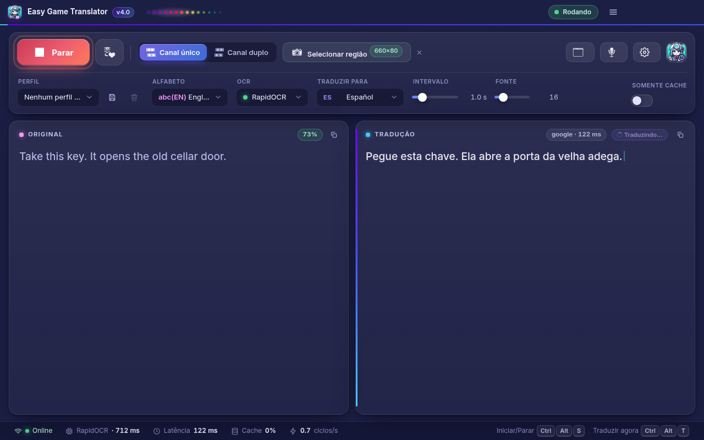
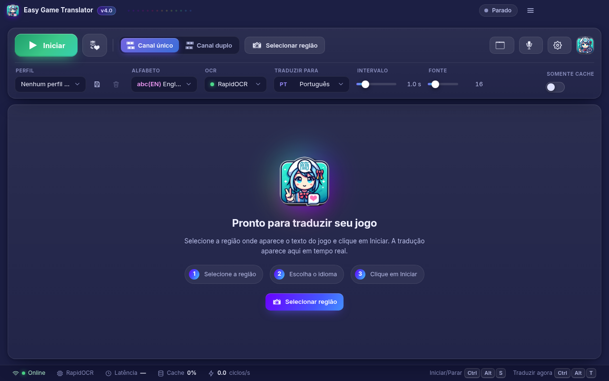
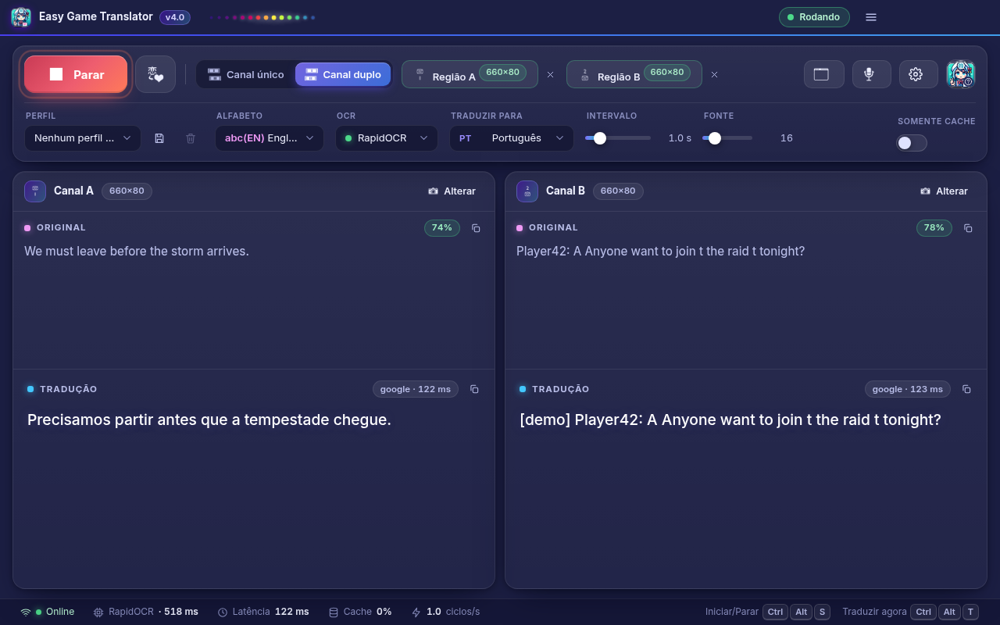
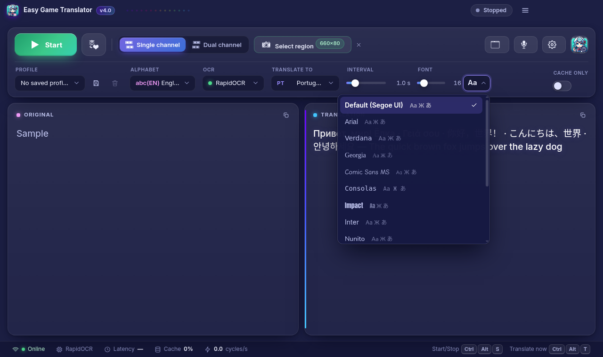
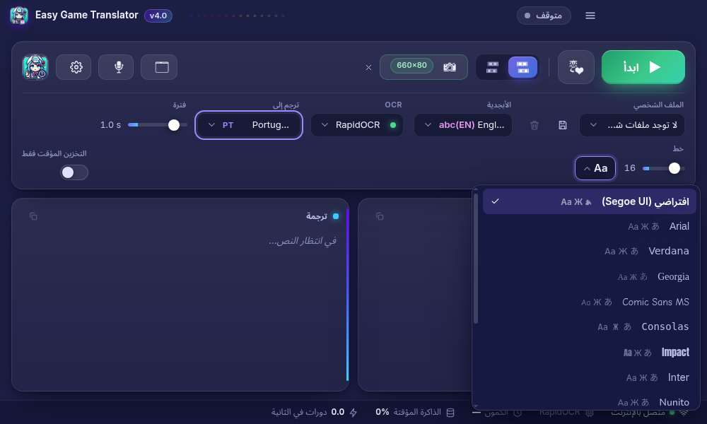
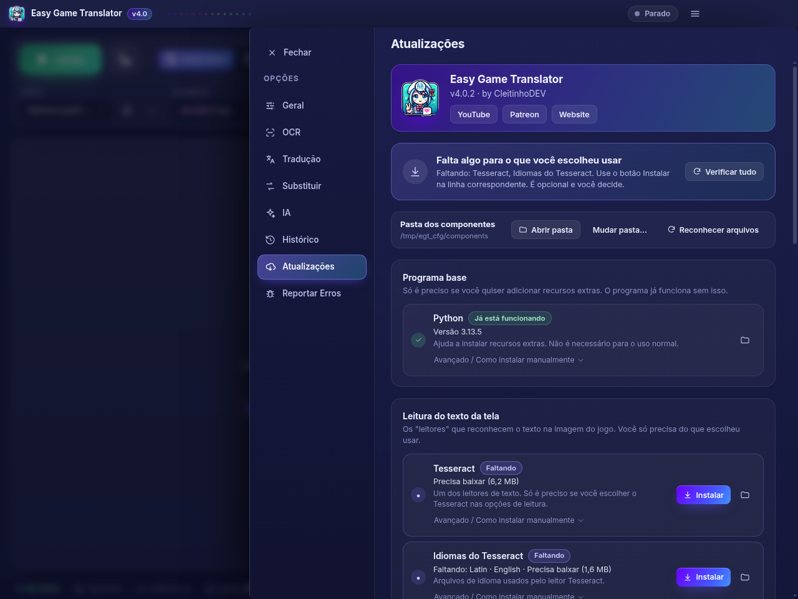
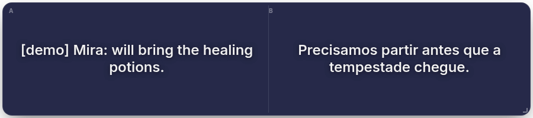

# Easy Game Translator v4

**Tradutor de jogos em tempo real com OCR** — por **CleitinhoDEV**.

Captura uma região da tela, lê o texto (OCR) e mostra a tradução na hora — na janela principal ou numa janela
flutuante (**Box Mode**) por cima do jogo. Interface em **Electron + React**, motor em **Python** (backend local FastAPI).
Funciona **offline** depois de instalado (OCR local, cache de traduções e motores offline opcionais).



**Índice:** [Iniciantes (passo a passo)](#iniciantes) · [Recursos](#recursos) · [Download](#download-e-instalação) ·
[Como usar](#como-usar) · [Perguntas frequentes](#perguntas-frequentes) · [Compilar](#compilar-a-partir-do-código) ·
[Licença](#licença) · [English](#english-summary)

> 🇺🇸 [English summary below](#english-summary)

## Recursos

- **Vários motores de OCR**: RapidOCR (embutido, já funciona sem instalar nada), Tesseract, EasyOCR; Paddle/WinOCR experimentais.
  Pré-processamento (escala, cinza, inversão automática, contraste, limiar, nitidez), detecção de mudança e estabilização do texto.
- **Tradutores online e offline** em ordem de prioridade, com **cache SQLite** e modo **somente cache/offline** (Argos Translate opcional).
- **Box Mode**: janela transparente, sempre no topo, arrastável/redimensionável, fonte automática, click-through opcional e
  excluída de prints/gravações (para o OCR não ler a própria tradução).
- **Canal duplo**: duas regiões ao mesmo tempo (ex.: chat + legenda).
- **Perfis por jogo**, **glossário/substituições**, histórico (exportar TXT/CSV/JSON), atalhos globais configuráveis.
- **IA opcional** (desligada por padrão): Gemini ou Ollama local para revisar traduções.
- **Gerenciador de componentes** (Opções › Atualizações): instala só o que você escolher usar, com tamanho, confirmação e progresso.
- **Interface em 20 idiomas** (pt-BR, en, es, fr, de, it, ru, uk, pl, tr, nl, id, vi, th, ar com RTL, hi, ja, ko, zh-CN, zh-TW).
- **14 fontes** para o texto traduzido (de sistema + 7 embutidas sob OFL), com alternativas para CJK, árabe, tailandês, hindi e cirílico.
- Tradução manual (digitar ou falar) com narração, intro com a Nina, Mica/Acrílico no Windows 11.

| | |
|---|---|
|  |  |
|  |  |
|  |  |

## Download e instalação

Baixe a versão mais recente em **[Releases](../../releases/latest)**:

- `EasyGameTranslator-<versão>-setup.exe` — instalador (Windows 10/11 x64; permite escolher a pasta);
- `EasyGameTranslator-<versão>-portable.exe` — versão portátil, sem instalar.

Confira o SHA-256 com `SHA256SUMS.txt` (PowerShell: `Get-FileHash .\arquivo.exe`).

> **Aviso do SmartScreen**: o executável **não é assinado** digitalmente, então o Windows pode mostrar
> "O Windows protegeu o computador". Clique em **Mais informações → Executar assim mesmo**.

## Iniciantes

Guia passo a passo, em linguagem simples. Escolha o seu sistema: **[Windows](#windows)** (o mais fácil) ou **[Linux](#linux)**.

### Windows

Funciona no **Windows 10 ou 11 (64 bits)**. **Não precisa instalar Python** nem mais nada para começar.

1. **Baixe** em [Releases](../../releases/latest) um destes arquivos:
   - `EasyGameTranslator-<versão>-setup.exe` → instala no computador (cria atalho na Área de Trabalho e no Menu Iniciar);
   - `EasyGameTranslator-<versão>-portable.exe` → não instala nada, é só abrir (bom para pendrive).
2. **Abra o arquivo baixado.** Se aparecer a tela azul **"O Windows protegeu o computador"** (SmartScreen), clique em
   **Mais informações** e depois em **Executar assim mesmo**. Isso acontece porque o programa não tem assinatura digital paga —
   não quer dizer que tem vírus.
3. **Instale** (no setup): avance as telas; se quiser, escolha outra pasta. No final, marque "Executar" ou abra pelo atalho.
4. **Primeira vez**: aparece uma intro com a Nina e música (clique ou aperte `Esc` para pular). Depois abre a **tela principal**.
5. **Selecione a região**: clique em **Selecionar região** e arraste um retângulo sobre o lugar do jogo onde aparece o texto
   (legenda, caixa de diálogo, chat). Dá para trocar depois.
6. **Escolha os idiomas**:
   - **Alfabeto** = o idioma/escrita **do jogo** (ex.: `abc(EN)` para jogos em inglês, japonês, coreano…);
   - **Traduzir para** = o idioma em que **você** quer ler (ex.: Português).
7. **OCR** (o "leitor" do texto da tela): deixe **RapidOCR**, que já vem junto e funciona sem instalar nada.
8. Clique em **Iniciar** (ou `Ctrl+Alt+S`). A tradução aparece na hora, no painel **Tradução**.
9. **Box Mode** (opcional): clique no botão do Box Mode (ou `Ctrl+Alt+B`) para abrir uma janelinha só com a tradução, que fica
   **por cima do jogo**. Arraste e redimensione como quiser.
10. **Modo de tela do jogo**: use **Janela** ou **Janela sem borda** (*borderless*) nas opções de vídeo do jogo.
    Em **tela cheia exclusiva** o Windows não deixa nenhuma janela aparecer por cima.

**Internet**: a tradução online precisa de internet. O que já foi traduzido fica guardado (**cache**) e funciona offline depois.
O OCR (RapidOCR) roda no seu computador, sem internet.

**Extras opcionais** (só se quiser): em **Opções (⚙) › Atualizações** o programa mostra o que pode ser instalado
(por exemplo o **Tesseract**, outro leitor de texto) com tamanho e botão **Instalar**. Em **Opções › IA** dá para usar
o **Gemini** (cole sua chave, criada em <https://aistudio.google.com/apikey>) ou o **Ollama** local (<https://ollama.com/download>).
Nada disso é obrigatório.

**Se algo der errado no Windows**

- **O programa não abre ou o OCR falha**: instale o **Microsoft Visual C++ Redistributable 2015–2022 (x64)** pelo link oficial da
  Microsoft: <https://aka.ms/vs/17/release/vc_redist.x64.exe> (página oficial: <https://learn.microsoft.com/cpp/windows/latest-supported-vc-redist>).
  Reinicie o computador e abra de novo.
- **O antivírus bloqueou / apagou o arquivo**: é comum com programas novos sem assinatura digital ("falso positivo").
  Baixe só daqui do [Releases](../../releases/latest), confira o SHA-256 (veja `SHA256SUMS.txt`) e, se confiar, adicione uma exceção no antivírus.
- **Onde ficam os logs** (para reportar erros): **Opções › Reportar Erros** mostra o caminho e tem o botão **Abrir pasta de logs**.
  O arquivo é `%APPDATA%\EasyGameTranslator\logs\egt.log`.

### Linux

**Não há versão pronta para Linux nos Releases** por enquanto: no Linux você roda **a partir do código** (e, se quiser,
gera um **AppImage** no seu próprio computador). Precisa de **Python**.

> **Importante — X11 × Wayland**: a captura de tela usa o X11. Funciona numa **sessão X11/Xorg** (ex.: na tela de login do Ubuntu,
> escolha "Ubuntu on Xorg"). Em sessões **Wayland** o sistema normalmente **bloqueia** a captura da tela de outros programas,
> e o OCR pode ler uma imagem preta ou vazia. Atalhos globais, click-through e "esconder de prints" do Box Mode foram feitos para o Windows.

**1. Instale os pré-requisitos** (git, Node.js 20 ou mais novo, Python 3.10+ com venv e pip; Tesseract é opcional):

Ubuntu / Debian:

```bash
sudo apt update
sudo apt install -y git curl python3 python3-venv python3-pip
# opcional: Tesseract + idiomas (ex.: inglês, português, japonês)
sudo apt install -y tesseract-ocr tesseract-ocr-eng tesseract-ocr-por tesseract-ocr-jpn
```

Fedora:

```bash
sudo dnf install -y git python3 python3-pip nodejs npm
sudo dnf install -y tesseract tesseract-langpack-eng tesseract-langpack-por   # opcional
```

Arch Linux:

```bash
sudo pacman -S --needed git python python-pip nodejs npm
sudo pacman -S --needed tesseract tesseract-data-eng tesseract-data-por       # opcional
```

**Node.js**: precisa ser a versão **20 ou mais nova** (`node --version`). Se a do seu sistema for mais antiga (comum no Ubuntu/Debian),
instale pelo **nvm** (<https://github.com/nvm-sh/nvm#installing-and-updating>) e rode `nvm install 22`, ou pelos pacotes
oficiais da NodeSource (<https://github.com/nodesource/distributions>). Página oficial: <https://nodejs.org/en/download>.

**2. Baixe o código.** O repositório é **privado**: você precisa ter acesso a ele (ou receber o `.zip` do código-fonte).

```bash
git clone https://github.com/cleitinhodev/easy_game_translator.git
cd easy_game_translator
```

(Com a GitHub CLI: `gh repo clone cleitinhodev/easy_game_translator`. Com o `.zip`: descompacte e entre na pasta.)

**3. Instale as dependências e rode:**

```bash
npm ci                    # bibliotecas do aplicativo (Electron etc.)
npm run setup:python      # cria a pasta .venv e instala o motor Python (inclui o RapidOCR)
npm run dev               # abre o programa
```

No Python **3.13 ou mais novo**, o RapidOCR usado é o pacote `rapidocr` (v3), que **baixa os modelos (~15 MB) na primeira leitura** —
deixe a internet ligada na primeira vez. Depois use igual ao Windows: **Selecionar região → Alfabeto / Traduzir para → Iniciar**.
Se o Tesseract estiver instalado no sistema, ele pode aparecer já selecionado em **OCR** — os dois funcionam; troque para RapidOCR se preferir.

**4. (Opcional) Gerar um AppImage** para abrir sem o terminal:

```bash
npm run setup:python -- --dev    # instala também o PyInstaller
# Debian/Ubuntu: o PyInstaller precisa da biblioteca do Python →  sudo apt install -y libpython3-dev
npm run build:backend            # empacota o motor Python para Linux (backend/dist/EGTBackend/)
npm run dist:linux               # gera release/EasyGameTranslator-<versão>-x86_64.AppImage
chmod +x release/EasyGameTranslator-*.AppImage
./release/EasyGameTranslator-*.AppImage
```

Se o AppImage não abrir ("AppImages require FUSE to run"): instale o FUSE 2 — Ubuntu 22.04: `sudo apt install libfuse2`;
Ubuntu 24.04+ / Debian 13: `sudo apt install libfuse2t64 fuse3` — ou rode com `--appimage-extract-and-run`. Se reclamar do *sandbox* (comum no Ubuntu 24.04+), acrescente `--no-sandbox`.
Logs no Linux: `~/.config/EasyGameTranslator/logs/egt.log`.

> **O que foi testado de verdade**: só **Debian 13 (trixie), Python 3.13, Node 20, X11 (xvfb)** — `git clone` → `npm ci` →
> `npm run setup:python` → `npm run dev`; captura real de uma região da tela com RapidOCR **e** com o Tesseract + tradução online;
> e o AppImage (`npm run setup:python -- --dev` → `npm run build:backend` → `npm run dist:linux`) abrindo e lendo a tela. Os comandos de Ubuntu, Fedora e Arch seguem a documentação oficial
> dessas distribuições, mas **não foram testados** aqui.

### Perguntas frequentes

**Preciso instalar Python?**
No **Windows, não** — já vem tudo dentro do instalador/portátil. No **Linux, sim** (o programa roda a partir do código).

**Funciona sem internet?**
O OCR (RapidOCR) e o **cache** funcionam offline: frases já traduzidas aparecem sem internet. Frases novas precisam de internet,
a não ser que você instale um tradutor offline (Argos, em Opções › Tradução / Atualizações) e ligue o modo **somente cache/offline**.

**O jogo em tela cheia não mostra a tradução.**
Em **tela cheia exclusiva** nenhuma janela aparece por cima. Mude o jogo para **Janela sem borda** (*borderless*) ou **Janela**.
Outra opção: deixe a tradução na janela principal, em outro monitor.

**O Windows avisou que é perigoso.**
É o SmartScreen avisando que o programa **não tem assinatura digital** (certificado pago). Baixe só dos [Releases](../../releases/latest),
confira o SHA-256 e clique em **Mais informações → Executar assim mesmo**.

## Como usar

1. Abra o jogo (de preferência em **janela sem borda** — tela cheia exclusiva não permite janelas por cima).
2. Clique em **Selecionar região** e arraste sobre a área onde aparece o texto (legenda, diálogo, chat).
3. Escolha o **Alfabeto** do jogo, o **OCR** e o idioma em **Traduzir para**.
4. Clique em **Iniciar** (ou `Ctrl+Alt+S`). A tradução aparece em tempo real; `Ctrl+Alt+T` traduz na hora.
5. Opcional: **Box Mode** (`Ctrl+Alt+B`) para ver a tradução por cima do jogo; **Canal duplo** para duas regiões;
   salve um **perfil** por jogo.

## Requisitos

- **Usar**: Windows 10/11 x64. Nada mais é obrigatório (o RapidOCR já vem junto). Tesseract, EasyOCR, Argos, Ollama etc. são opcionais.
- **Desenvolver**: Node.js 20+ e Python 3.10+ (recomendado 3.12).

## Compilar a partir do código

```bash
npm install
npm run setup:python          # cria .venv e instala o backend  (use --optional para os extras)
npm run dev                   # Vite (HMR) + Electron + backend Python
```

| Comando | O que faz |
|---|---|
| `npm run build` | typecheck (tsc) + build do renderer (Vite) em `dist/` |
| `npm test` | confere i18n + typecheck + testes do backend (pytest) |
| `npm run check:links` | confere links externos / CSP |
| `npm run build:backend` | empacota o backend com PyInstaller (onedir) em `backend/dist/EGTBackend/` |
| `npm run dist:win` | gera instalador NSIS + portátil em `release/` (precisa do backend empacotado) |
| `npm run dist:linux` | gera um AppImage para Linux em `release/` (precisa do backend empacotado **no Linux** — veja [Linux](#linux)) |
| `npm run e2e:shots` | Electron sob `xvfb` em modo demonstração (ex.: `bash scripts/e2e/run.sh dropdowns.cjs`) |

Variáveis úteis: `EGT_PYTHON` (outro Python), `EGT_CONFIG_DIR` (pasta de configuração), `EGT_DEMO=1` (captura e tradutor sintéticos — só para testes de UI).

### Gerar o executável do Windows

No **Windows** (recomendado):

```powershell
npm install
python -m venv .venv ; .\.venv\Scripts\pip install -r backend\requirements-bundle.txt
npm run build:backend         # backend\dist\EGTBackend\EGTBackend.exe
npm run dist:win              # release\EasyGameTranslator-<versão>-setup.exe  e  ...-portable.exe
```

No **Linux** (cross-build com Wine; foi como o pacote de teste foi gerado):

```bash
# Python 3.12 do Windows dentro do Wine (~/.wine/drive_c/Python312)
wine ~/.wine/drive_c/Python312/python.exe -m pip install -r backend/requirements-bundle.txt
(cd backend && wine ~/.wine/drive_c/Python312/python.exe -m PyInstaller --noconfirm --clean EGTBackend.spec)
npx electron-builder --win dir --x64           # pasta release/win-unpacked/
```

Versões fixadas no pacote do Windows: numpy 1.26.4, onnxruntime 1.20.1, opencv-python-headless 4.10.0.84, rapidocr-onnxruntime 1.4.4.
O executável do backend tem um autoteste oculto: `EGTBackend.exe --selftest` (lê uma imagem gerada com o RapidOCR).

### Arquitetura

```
┌──────────────────────── Electron (Node) ────────────────────────┐
│ main.cjs  → janelas (principal, Box Mode, seletores de região), │
│            tray, atalhos globais, menu nativo, instância única   │
│ backend.cjs → inicia/encerra o Python, lê "EGT_READY {porta}"   │
│ preload.cjs → contextBridge: expõe só funções específicas       │
└──────────────┬──────────────────────────────────────────────────┘
               │ porta + token (aleatórios a cada execução)
┌──────────────▼────────────── Renderer (React + TS + Vite) ──────┐
│ UI, i18n (shared/i18n/*.json), animações (motion), zustand      │
└──────────────┬──────────────────────────────────────────────────┘
               │ REST (comandos/config) + WebSocket (eventos ao vivo)
┌──────────────▼────────────── Backend Python (FastAPI) ──────────┐
│ 127.0.0.1 · porta livre aleatória · token obrigatório            │
│ captura (mss) → pré-processo → OCR → substituições → tradução    │
│ (cache SQLite → motores em ordem) → histórico                    │
└──────────────────────────────────────────────────────────────────┘
```

Segurança: o backend só escuta em `127.0.0.1`, exige o token em **toda** rota (header `X-EGT-Token`; `?token=` no WebSocket),
valida o header `Host` (anti DNS-rebinding) e a origem (CORS) e mascara chaves secretas nas respostas.
O renderer roda com `contextIsolation`, `sandbox`, `nodeIntegration` desligado e CSP estrita; links externos só `https`.
**Nenhuma chave de API vai no projeto**: chaves (Gemini/Azure/Libre) vêm de variável de ambiente
(`GEMINI_API_KEY`) ou das Opções, e ficam só na pasta de configuração do usuário
(Windows: `%APPDATA%\EasyGameTranslator`; Linux: `~/.config/EasyGameTranslator`).

## Estrutura

```
backend/   egt/ (motor v3 adaptado + server/ FastAPI)  main.py  tests/  EGTBackend.spec
electron/  main.cjs  windows.cjs  backend.cjs  preload.cjs  util.cjs
src/       App.tsx  store.ts  components/  settings/  views/  styles/  lib/  api/
shared/    i18n/<idioma>.json (20 idiomas) + _locales.json
scripts/   dev.mjs  check-links.mjs  publish-github.md  setup-python.mjs  build-backend.mjs  test-backend.mjs  check-i18n.mjs  e2e/
build/ resources/   ícones (.ico/.png), bandeja e licenças das fontes
docs/      screenshots/
```

## Ajude a traduzir
Os textos ficam em `shared/i18n/<código>.json` (chaves planas; `pt-BR.json` é a referência). Os idiomas além de pt-BR e en foram
gerados com **ajuda de tradução automática** e revisados nos termos principais — podem ter frases estranhas. Para corrigir, edite o
arquivo do idioma mantendo `{n}`, `{name}` etc. e os nomes OCR, Tesseract, CleitinhoDEV e Nina, rode `npm run check:i18n` e envie.
Fontes e licenças: `THIRD_PARTY_NOTICES.md`.

## Limitações conhecidas

- Click-through, exclusão de captura, Mica/Acrílico, atalhos globais, bandeja e DPI do seletor dependem do Windows real;
  foram implementados seguindo a API do Electron, mas só puderam ser testados em Linux/xvfb durante o desenvolvimento.
- Jogos em **tela cheia exclusiva** não permitem janelas por cima: use "Janela sem borda" no jogo.
- Microfone: usa o reconhecimento do Google (precisa de internet). Narração: gTTS (internet).
- EasyOCR/Argos baixam modelos grandes e ficam fora do pacote por padrão (instale com `pip` — veja Opções › OCR).

## Histórico de versões

Veja o [CHANGELOG.md](CHANGELOG.md).

## Licença

Copyright (C) 2026 CleitinhoDEV

Este programa é software livre: você pode redistribuí-lo e/ou modificá-lo sob os termos da **GNU General Public License**
publicada pela Free Software Foundation, **versão 3** da licença ou (a seu critério) qualquer versão posterior
(`GPL-3.0-or-later`). Ele é distribuído na esperança de ser útil, mas **SEM QUALQUER GARANTIA**. Veja o arquivo [LICENSE](LICENSE).

Componentes de terceiros (fontes OFL, Electron, bibliotecas Python etc.): [THIRD_PARTY_NOTICES.md](THIRD_PARTY_NOTICES.md).

## Links

- Site: <https://www.bugzinho.com/easygametranslator>
- Patreon: <https://www.patreon.com/CleitinhoDEV>
- GitHub: <https://github.com/cleitinhodev>
- **Doações**: <https://www.bugzinho.com/donate>

---

## English summary

**Easy Game Translator** is a real-time screen translator for games by **CleitinhoDEV**: select a region of the screen,
it reads the text with OCR (RapidOCR built in; Tesseract/EasyOCR optional) and shows the translation live — in the main
window or in a transparent always-on-top **Box Mode** overlay. Features: online and offline translators with SQLite cache,
dual channel (two regions), per-game profiles, glossary/replacements, history export, optional AI (Gemini/Ollama),
an optional component manager, **20 UI languages** (including Arabic RTL) and 14 fonts for the translated text.

- **Download**: see [Releases](../../releases/latest) (`-setup.exe` installer or `-portable.exe`, Windows 10/11 x64).
  The executables are **not code-signed**, so SmartScreen may warn: click *More info → Run anyway*.
- **Use**: *Select region* → choose alphabet/OCR/target language → *Start* (`Ctrl+Alt+S`). `Ctrl+Alt+B` toggles Box Mode.
- **Beginners** (full step-by-step in Portuguese: [Iniciantes](#iniciantes)):
  - *Windows*: no Python needed. Download the setup or portable `.exe`, on SmartScreen click *More info → Run anyway*,
    then *Select region* → *Alphabet* (game language) + *Translate to* → keep *RapidOCR* → *Start*. Run the game in
    windowed/borderless mode (exclusive fullscreen hides overlays). If it won't start, install the official
    [Visual C++ Redistributable x64](https://aka.ms/vs/17/release/vc_redist.x64.exe). Logs: *Options › Report bugs*.
  - *Linux*: no prebuilt release yet — run from source: install git, Node.js 20+, Python 3.10+ (venv, pip), then
    `npm ci && npm run setup:python && npm run dev`; optional AppImage with `npm run dist:linux`. Screen capture needs an
    **X11** session (Wayland usually blocks it). Tested only on Debian 13 / Python 3.13 / X11.
- **Build**: `npm install && npm run setup:python && npm run dev`; release build: `npm run build:backend && npm run dist:win`.
- **Translate the UI**: edit `shared/i18n/<code>.json` (keep `{placeholders}` and product names), run `npm run check:i18n`.
  Non-Portuguese/English locales were machine-assisted and may contain mistakes — fixes are welcome.
- **License**: GPL-3.0-or-later — Copyright (C) 2026 CleitinhoDEV. Donations: <https://www.bugzinho.com/donate>
